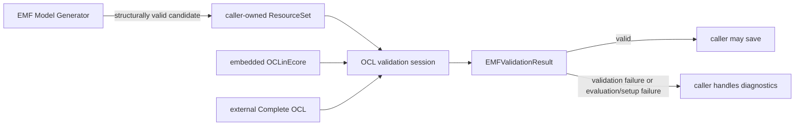

# EMF Model Generator OCL

`emf-model-generator-ocl` is an optional, headless OCL validation companion for
[`emf-model-generator`](https://github.com/LorenzoBettini/emf-model-generator). It validates
complete generated EMF models after generation. A successful result means that the selected roots
are OCL-valid with respect to the configured constraints.

This project does not direct value assignment, retry generation, search for models, repair invalid
models, or prove that a metamodel is satisfiable. The core generator remains independently
installable and has no Eclipse OCL dependency.

## Requirements and build

The build requires Java 21 but does not require an installed Eclipse IDE. CI runs the same
command on Ubuntu, Windows, and macOS, enabling the `jacoco` coverage profile on Linux only:

```sh
./mvnw clean verify # Windows and macOS
./mvnw clean verify -Pjacoco # Linux (also the local coverage command)
```

For a faster local run of the OSGi test bundle and its required reactor dependencies, use:

```sh
./mvnw verify -am -pl :io.github.lorenzobettini.emfmodelgenerator.ocl.tests \
  -Dtycho.localArtifacts=ignore
```

This focused command does not assemble or install the feature and p2 repository, and does not
replace the full verification command for CI or releases.

The default build runs the headless OSGi test suite and assembles the companion p2 repository.
Coverage is opt-in through `jacoco`. Installation of the generated repository is also opt-in and is
deliberately not run by GitHub Actions. Verify both the runtime and source features with p2 Director
using the dedicated profile:

```sh
./mvnw clean verify -Prepository-verification
```

Combine profiles when both coverage and repository installation must be checked:

```sh
./mvnw clean verify -Pjacoco,repository-verification
```

The `repository-verification` profile follows the generated repository's references and therefore
checks installation resolution against the configured Eclipse, Eclipse OCL, and core update sites.
Run it before a release and after changing feature/category metadata, manifests, target-platform or
dependency configuration, or repository assembly. It is not needed for ordinary source-only
changes. Outputs include:

- p2 repository:
  `releng/io.github.lorenzobettini.emfmodelgenerator.ocl.repository/target/repository/`;
- installed-resolution fixture (with `repository-verification`):
  `releng/io.github.lorenzobettini.emfmodelgenerator.ocl.repository/target/installation/`;
- source-feature installation fixture (with `repository-verification`):
  `releng/io.github.lorenzobettini.emfmodelgenerator.ocl.repository/target/source-installation/`;
- JaCoCo report:
  `releng/io.github.lorenzobettini.emfmodelgenerator.ocl.quality/target/site/jacoco/`.

The build pins Tycho 5.0.4 and uses the Eclipse 2026-06 composite repository, the Eclipse OCL
6.24.0 release repository, and a Maven target location for
`io.github.lorenzobettini:emf-model-generator:1.1.0`. Bundle requirements accept backward-compatible
minor and patch updates.

To test a new core version locally, install that project into the local Maven repository, update the
version in `releng/io.github.lorenzobettini.emfmodelgenerator.ocl.target/emf-model-generator-ocl.target`,
and run this project's build. The core project is not added to this reactor; the target consumes its
installed artifact. A released version can be resolved from a configured Maven repository when it
is not already present locally.

## Installation

The OCL validation companion is optional. Its update site is the repository generated by this
project and published separately from the core update site. Configure these sites when installing:

- companion: `emf-model-generator-ocl` p2 repository produced by this project (the release artifact
  or its separately published URL);
- core: `https://lorenzobettini.github.io/emf-model-generator-update-site/1.1.0`;
- Eclipse OCL 6.24.0: `https://download.eclipse.org/modeling/mdt/ocl/builds/release/6.24.0`;
- Eclipse 2026-06: `https://download.eclipse.org/releases/2026-06`.

Install the `EMF Model Generator OCL` feature from the companion site. Its p2 metadata requires the
core bundle and OCL bundles, so p2 resolves them from the other sites. Installing only the core
feature does not install Eclipse OCL. The build verifies this resolution without rebuilding or
copying the core project.

For source attachment in Eclipse, install the separate `EMF Model Generator OCL Source` feature.
It contains the generated `io.github.lorenzobettini.emfmodelgenerator.ocl.source` bundle. The
source feature is independently installable and is verified from the generated p2 repository.

## Constraint sources

- **Embedded OCLinEcore** uses Pivot OCL invariants stored in standard Ecore annotations. Create a
  session with `OCLModelValidator.forOCLinEcore(resourceSet)`.
- **External Complete OCL** keeps constraints in a separate `.ocl` document. Create a session with
  `OCLModelValidator.forCompleteOCL(resourceSet, oclURI)`. Relative imports resolve from that URI,
  and validation does not add or persist annotations in the imported Ecore model.

Both modes use the caller's `ResourceSet`, preserve the complete EMF diagnostic tree, and reject
warning-level invariant diagnostics by default. Parsing, resolution, and evaluator problems are
reported as `EMFValidationKind.VALIDATOR_FAILURE` rather than ordinary
`EMFValidationKind.VALIDATION_FAILURE` outcomes.

## Result-based validation

The primary workflow uses the generic validation facilities in EMF Model Generator 1.1.0. The
generator supplies its exact `ResourceSet`, creates one OCL session for the call, and closes it
afterwards:

```java
EMFModelGenerator generator = new EMFModelGenerator();
EPackage ePackage = generator.loadEcoreModel("model/education.ecore");
EClass schoolClass = (EClass) ePackage.getEClassifier("School");
generator.generateFrom(schoolClass);

EMFValidationResult result = generator.validate(OCLModelValidator::forOCLinEcore);
if (!result.isValid()) {
	result.flattenedDiagnostics().forEach(diagnostic ->
			System.err.println(diagnostic.getMessage()));
}
```

`result.diagnostic()` retains the original tree. `result.kind()` distinguishes a normal
`EMFValidationKind.VALIDATION_FAILURE` from `EMFValidationKind.VALIDATOR_FAILURE`, which represents
OCL setup, parser, resolution, or evaluation failure. OCL uses `Diagnostic.WARNING` as its rejection
threshold because Eclipse OCL may report a false Boolean invariant as a warning; this deliberately
differs from the core standard EMF validator's `Diagnostic.ERROR` threshold.

Complete OCL uses a factory lambda that captures the constraints URI:

```java
URI constraints = URI.createFileURI("model/constraints/education.ocl");
EMFValidationResult result = generator.validate(
		resourceSet -> OCLModelValidator.forCompleteOCL(resourceSet, constraints));
```

## Validation before save

Generation happens first; OCL validation follows and does not retry generation, repair the result,
or change any generated value. For strict persistence, enable validation before saving so an invalid
candidate throws `EMFValidationException` before the output directory is created or any resource is
serialized:

```java
EMFModelGenerator generator = new EMFModelGenerator();
try {
	EPackage ePackage = generator.loadEcoreModel("model/education.ecore");
	EClass schoolClass = (EClass) ePackage.getEClassifier("School");
	generator.generateFrom(schoolClass);

	generator.enableValidationBeforeSave(OCLModelValidator::forOCLinEcore);
	generator.save();
} catch (EMFValidationException exception) {
	EMFValidationResult result = exception.getResult();
	// Handle a validation failure or validator failure; nothing was serialized.
} finally {
	generator.unloadEcoreModels();
}
```

For Complete OCL, pass the corresponding factory lambda:

```java
generator.enableValidationBeforeSave(
		resourceSet -> OCLModelValidator.forCompleteOCL(resourceSet, constraints));
generator.save();
```

## Round-trip validation

Use the core round-trip facility to save, reload all saved resources into a fresh `ResourceSet`,
and validate the reconstructed graph with OCL:

```java
EMFValidationResult roundTripResult = generator.saveAndValidateRoundTrip(
		null, OCLModelValidator::forOCLinEcore);
```

Complete OCL uses the same factory-lambda pattern:

```java
EMFValidationResult roundTripResult = generator.saveAndValidateRoundTrip(
		null,
		resourceSet -> OCLModelValidator.forCompleteOCL(resourceSet, constraints));
```

The factory receives the fresh round-trip `ResourceSet`, and the generator closes the OCL session
after validation. This operation validates the deserialized graph after files have been written; a
non-valid result does not remove those files. Enable validation before save as shown above as well
when an invalid in-memory candidate must prevent serialization.

## Reusable direct sessions

Create a validator directly when several validations should reuse one initialized OCL environment,
as in evaluation or performance loops. A directly managed session must be closed by the caller:

```java
try (OCLModelValidator validator =
		OCLModelValidator.forOCLinEcore(generator.getResourceSet())) {
	for (EObject root : generatedRoots) {
		validator.validateOrThrow(root); // inherited; throws EMFValidationException
	}
}
```

`validateAll` accepts an empty collection as a valid aggregate, while rejecting a null collection
or null elements. A Complete OCL setup failure remains a validator failure even with no roots.

## Controlled evaluation experiment

`OCLValidationExperimentTest` provides an opt-in, headless experiment over explicitly selected
ages for the education fixture. Each candidate has a fresh generator, `ResourceSet`, resource, and
validator; the finite sweeps are caller-chosen configurations, not generator retries or search.
Run it with:

```sh
./mvnw verify -am -pl :io.github.lorenzobettini.emfmodelgenerator.ocl.tests \
  -Dtycho.localArtifacts=ignore -Dtest=OCLValidationExperimentTest \
  -Dtycho.testArgLine=-Docl.validation.experiment=true
```

The test writes `observations.csv` and `summary.txt` below
`tests/io.github.lorenzobettini.emfmodelgenerator.ocl.tests/target/ocl-validation-experiment/`.
CSV columns identify the scenario, configured age, validation kind, model size, invariant
diagnostic, generation time, OCL setup-plus-first-validation time, and their continuous combined
interval. Normal builds retain deterministic semantic assertions but skip measurement and report
generation. Timings are machine-sensitive observations without performance thresholds.

## Architecture and lifecycle



The companion's only public type is `OCLModelValidator`, which extends the core
`EMFModelValidator`; generic result, outcome, and exception types come from core 1.1.0. The exported
API contains no Eclipse OCL implementation types. Internal adapters initialize one OCL
environment per session, use ResourceSet-local validators and resource factories, restore replaced
local registrations, dispose environments, and unload temporary Complete OCL resources in
`close()`. Generator factory-based calls close their sessions automatically; direct sessions belong
in try-with-resources.

## Limitations

- Validation is post-generation only; the core generator guarantees structural validity but does
  not enforce arbitrary OCL invariants while assigning values.
- A validation failure describes one candidate. It does not show that the metamodel or constraints
  are unsatisfiable.
- There are no retries, search budgets, repair, backtracking, or solver integration.
- The initial release supports dynamic/generated Ecore with embedded Pivot OCL and external Complete
  OCL. It does not claim support for every OCL construct or UML metamodel validation.
- The implementation has a 6.24.0 OCL baseline, accepts compatible 6.x updates exposed through the
  selected OCL repository, and isolates the small set of internal delegate APIs needed for
  ResourceSet-local setup. OCL 7 requires a separate compatibility review.
- Callers must validate complete roots and must follow the core generator's lifecycle, including
  `unloadEcoreModels()` after `loadEcoreModel()`.

## Quality and release

See [RELEASING.md](RELEASING.md) for versioning, verification, and publication steps, and
[DEPENDENCIES.md](DEPENDENCIES.md) for dependency and license information. PIT was investigated but
is not a build gate: the tests require Tycho's OSGi runtime, while PIT's Maven runner uses a regular
Maven test classpath. Maintaining a second non-OSGi test setup would duplicate manifest-first
dependency metadata and would not exercise the production runtime. The real OSGi suite and enforced
JaCoCo threshold remain the quality gates.

## License

Eclipse Public License 2.0. See [LICENSE](LICENSE).
